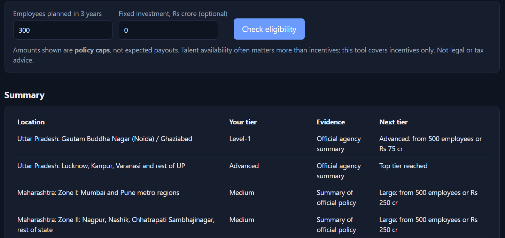
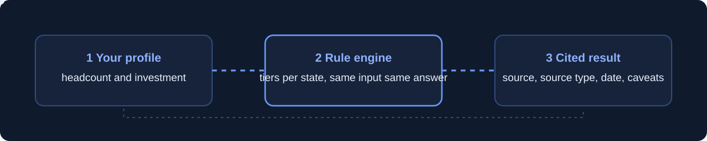
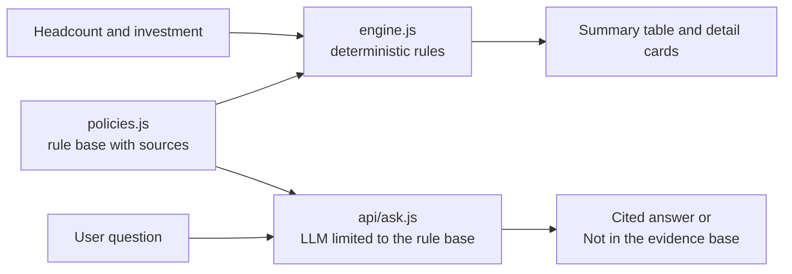
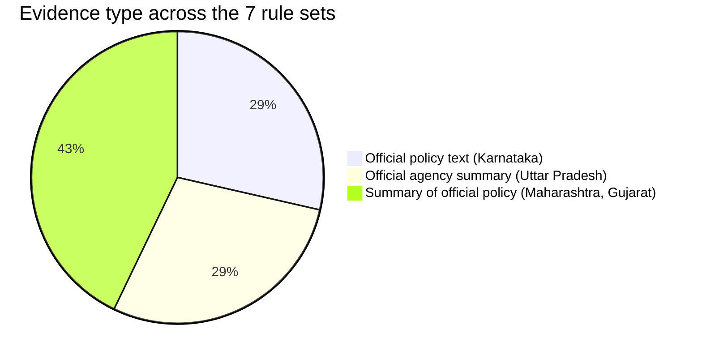
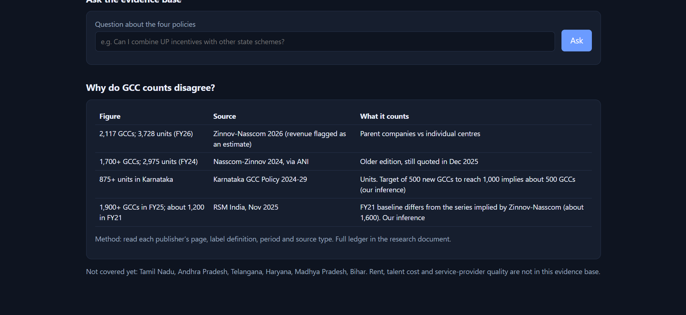

<div align="center">


**Which state incentives would your first India GCC qualify for, and how sure are we?**

[](https://gcc-compass-orcin.vercel.app)
[](https://github.com/A-yushupadhyay/gcc-compass/actions)


</div>

A prototype built for the **Flexiple Product Intern assignment**. It turns scattered, conflicting state incentive policies into a sourced, dated and honestly labelled shortlist for a team planning its first GCC in India.

<p align="center"></p>

## Why this exists

India has 2,000+ Global Capability Centres, yet the public numbers disagree on basics. Nobody shows the definition next to the figure, so first-time entrants fall back on referrals.

| Figure | Source | Why it differs |
|---|---|---|
| 2,117 GCCs, 3,728 units (FY26) | Zinnov-Nasscom 2026 | GCCs (parent companies) versus units (centres); revenue is an estimate |
| 1,700+ GCCs, 2,975 units (FY24) | Nasscom-Zinnov 2024 | Older edition, still quoted in Dec 2025 |
| 875+ units in Karnataka | Karnataka GCC Policy 2024-29 | Units, not GCCs. The 500-new-to-1,000 target implies about 500 GCCs (our inference) |
| 1,900+ GCCs (FY25), about 1,200 (FY21) | RSM India, Nov 2025 | FY21 baseline does not match the Zinnov-Nasscom series (our inference) |

**The gap:** no public tool matches a company's size to the incentives it qualifies for across states, with the evidence shown.

## What it does

- **Eligibility engine.** Enter planned headcount and fixed investment. Get the tier you meet in Uttar Pradesh, Maharashtra, Karnataka and Gujarat, the main incentives (as policy caps, not payouts), and what the next tier needs.
- **Evidence on every rule.** Each location shows its source link, source type, date, caveats and a last-checked date.
- **Grounded assistant.** A question box that answers only from the rule base and says *Not in the evidence base* when it cannot.
- **Why counts disagree.** A table that puts definitions, periods and inferences next to each published number.



## How it works



The eligibility result is **plain code, not LLM output**: the same inputs always give the same answer, and the engine has automated tests. The LLM is used only to answer questions, and it is instructed to use only the rule base.

## Honest by design

| Principle | How it shows up |
|---|---|
| Show the source | Every rule links to its document, with a date |
| Label the evidence | Each location carries an evidence badge (below) |
| Do not rank | Results are grouped by state, because caps of different types are not comparable |
| Say what is missing | A visible list of states, and data types, that are not covered |
| Separate fact from inference | Inferences are marked "our inference" |



## Example

Profile: **300 employees, no stated investment.**

| Location | Your tier | Evidence |
|---|---|---|
| Uttar Pradesh, Noida / Ghaziabad | Level-1 | Official agency summary |
| Uttar Pradesh, rest of state | Advanced | Official agency summary |
| Maharashtra, Zone I and Zone II | Medium | Summary of official policy |
| Karnataka, Bengaluru Urban | General support only | Official policy text |
| Karnataka, Beyond Bengaluru | 100+ employees | Official policy text |
| Gujarat | Category I (investment under Rs 250 cr) | Summary of official policy |

## Assistant behaviour (observed)

| Question | Response |
|---|---|
| Can I combine UP incentives with other state schemes? | Not with other state policies; yes with central schemes, citing the UP rule sets |
| What is the office rent in Hyderabad? | *Not in the evidence base.* |
| Which state is best for a 300-person GCC? | *Not in the evidence base: this tool does not rank options.* |

<details>
<summary><b>Counts explainer screenshot</b></summary>
<br>

</details>

## Project structure

```text
gcc-compass/
├── index.html              UI: form, summary table, detail cards, assistant, counts table
├── engine.js               deterministic eligibility engine
├── policies.js             rule base: tiers, incentives, notes, sources
├── api/ask.js              serverless route; calls the LLM with the rule base only
├── tests/engine.test.js    engine tests (node:test)
├── .github/workflows/      CI that runs the tests
└── assets/ docs/           README visuals
```

## Run locally

```bash
git clone https://github.com/A-yushupadhyay/gcc-compass.git
cd gcc-compass
npm test                     # engine tests, Node 20+
npx serve .                  # try the UI (the assistant needs the serverless route)
```

To run the assistant locally, use `npx vercel dev` with `GEMINI_API_KEY` set in a local environment file. Never commit keys.

## Deploy

Import the repo in Vercel (framework: Other) and set `GEMINI_API_KEY`. Optionally set `GEMINI_MODEL` if the default model is retired.

## Data provenance and limits

- Rules checked on **26 Oct 2026**. Uttar Pradesh: official agency summary. Karnataka: official policy text. Maharashtra and Gujarat: professional-firm summaries of the official policies, labelled in the app and **not yet checked against the official PDFs**.
- **Not covered:** Tamil Nadu, Andhra Pradesh, Telangana, Haryana, Madhya Pradesh, Bihar. No rent, talent cost or service-provider data.
- Incentive amounts are **policy caps, not expected payouts**. Some incentives have annual beneficiary limits. Not legal or tax advice.
- Talent often matters more than incentives for location choice; this tool covers incentives only.
- No customer interviews were conducted. Stakeholder needs in the accompanying deck are research-based hypotheses.

## Roadmap

- [x] Eligibility engine for four states, with sources and tests
- [x] Grounded assistant that declines unsupported questions
- [ ] Check Maharashtra and Gujarat against the official PDFs
- [ ] Add Tamil Nadu and Andhra Pradesh
- [ ] Side-by-side compare view
- [ ] Service-provider delivery evidence (publicly documented engagements, not self-claims)
- [ ] Validate with GCC leaders whether incentives change their shortlist

---

<div align="center">Built by <a href="https://github.com/A-yushupadhyay">Ayush Upadhyay</a> for the Flexiple Product Intern assignment.</div>
